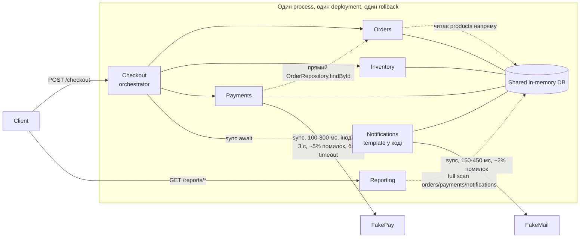
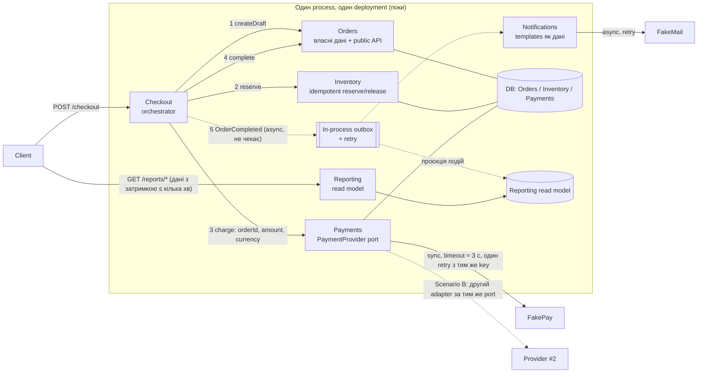

# OrderFlow: Architecture Analysis (рівень 75)

> Основа аналізу: `docs/*`, код `src/*` і запуск `npm test` (5/5 pass). Де число є моєю оцінкою, а не даними з документів, це позначено як **assumption**.

## Короткий висновок

**Modular monolith залишається. Rewrite і розбиття на services не потрібні.** Delivery friction зараз спричинена трьома конкретними місцями в коді: Payments читає чужий repository, Notifications стоїть у critical path checkout, а Reporting читає ті самі дані, що й checkout. Усі три виправляються всередині одного process, без нової інфраструктури.

---

## 1. Current architecture



### Responsibilities та dependencies

| Модуль | Відповідальність | Залежить від | Оцінка |
| --- | --- | --- | --- |
| **Checkout** | Координує flow: draft → reserve → charge → complete → email | Orders, Inventory, Payments, Notifications | Orchestrator має знати учасників, тож це виправдано. Проблема лише в `await` на email |
| **Orders** | Життєвий цикл замовлення, розрахунок total | Shared DB, **`database.products` (дані Inventory)** | Дрібний leak: ціна береться напряму з таблиці товарів |
| **Inventory** | Перевірка та резерв, release | Shared DB | **Здорово.** Idempotency keys `reserve:<id>` / `release:<id>` вже є (Scenario D) |
| **Payments** | Виклик provider, запис платежу, idempotency по captured | **`OrderRepository` модуля Orders**, FakePay | **Шкідливо:** залежність від чужих даних і від їх форми (`order.totalCents`, `order.currency`) |
| **Notifications** | Template + відправка email | FakeMail, Shared DB | **Шкідливо в critical path.** Template зашитий у `NotificationService`, тож кожен marketing-експеримент це зміна коду всього застосунку |
| **Reporting** | Sales summary, operational health | Shared DB (orders, payments, notifications) | **Ризикова.** Full scan з вкладеним `find` на кожен order (O(n·m)), у тому ж process, що й checkout |

---

## 2. Проблеми, які справді видно

| # | Проблема | Evidence (факт) | Причинний зв'язок |
| --- | --- | --- | --- |
| 1 | **Payments ↔ Orders coupling** | `PaymentService.chargeOrder` викликає `orderRepository.findById`; 48% feature PR торкаються Orders і Payments; Modules Changed per Feature 1,7 → 4,3 | Зміна форми Order ламає Payments, а нове payment rule вимагає змін в обох модулях. *Припущення*, що це головна причина зростання PR size (180 → 520 LOC) |
| 2 | **Email у critical path і неправильна обробка його збою** | Коментар у коді: «Deliberate critical-path dependency». 37% змін templates потребують повного regression checkout | Template міняється часто, а тестується весь checkout |
| 3 | **Знайдений defect: клієнт оплатив, а order став `FAILED`** | Я запустив checkout з `NOTIFICATION_FAILURE_RATE=1`. Результат: payment `CAPTURED`, order `FAILED`, stock повернуто на склад | Збій email потрапляє в `catch` у `CheckoutService`, який робить `release` і `fail` вже після успішної оплати. При 2% збоїв email це ~2% оплачених замовлень зі списаними коштами та без замовлення |
| 3b | Provider latency б'є по checkout | Немає timeout; два останні інциденти почалися з payment latency spike; ~10% викликів повільні (1,5-3 с) | Один повільний provider тримає request, а fallback відсутній |
| 4 | **Один deployment** | Release Frequency 5 → 2/тиждень; Rollback 2% → 9%; MTTR 35 → 95 хв; Deployment 8 → 27 хв | Зміна templates потребує release всього і rollback повертає все |
| 5 | **Reporting росте разом із checkout** | Traffic ×3 за рік, прогноз ×8-10 (Scenario C) | Спільні process і дані. Для checkout це ризик латентності |

**Що не доведено.** Метрики лише корелюють з архітектурою. Deployment Duration частково зросла через ручні approval і більший test suite (це process, не architecture). Rollback 9% і MTTR 95 хв можуть залежати й від якості тестів. Це треба перевіряти вимірюванням, а не вважати доведеним.

---

## 3. Architectural characteristics (за пріоритетом)

| # | Characteristic | Чому саме тут |
| --- | --- | --- |
| 1 | **Reliability / availability checkout** | Прямий вплив на revenue, Scenario E. Проблема 3 це вже факт, а не гіпотеза |
| 2 | **Data consistency (Inventory, Payments)** | Overselling і «оплачено, але FAILED» неприйнятні (Scenario D) |
| 3 | **Modifiability** | 4,3 модуля на feature, Scenarios A, B, F |
| 4 | **Deployability** | Rollback 9%, Deployment 27 хв. Важливо, але вирішується частково через pipeline |
| 5 | **Performance / scalability Reporting** | Важливо, але дані з точністю до хвилин прийнятні (Scenario C), тож є простір для компромісу |

**Чим поступаємося:** миттєвою доставкою email (бізнес сам сказав, що вона менш важлива за availability), «чистотою» повної ізоляції даних, незалежним scaling зараз і простотою синхронного коду в Checkout.

---

## 4. Proposed architecture

Рішення: **evolution всередині modular monolith**. Три цілеспрямовані зміни boundary, один fitness-тест і timeout для provider.



### Що змінюється і як це пов'язано зі scenarios

| # | Зміна | Закриває | Деталі |
| --- | --- | --- | --- |
| **C1** | **Прибрати `OrderRepository` з Payments.** Checkout передає `{orderId, amountCents, currency}`; Payments не знає про Orders | Проблема 1; Scenarios B, F | Payments стає самодостатнім. Другий provider (Scenario B) додається як adapter за `PaymentProvider` port, без змін в Orders |
| **C2** | **Email винести з critical path:** Checkout публікує `OrderCompleted` в in-process outbox, Notifications відправляє з retry. Збій email більше не впливає на order | Проблема 2 і 3; Scenarios A, E | Виправляє defect «оплачено, але FAILED». Template переїжджає в окремі дані всередині Notifications, тож зміна експерименту торкається лише цього модуля |
| **C3** | **Timeout 3 с для provider + обробка timeout як окремого стану** («невідомий результат», потрібна перевірка статусу, а не повторне списання) | Проблема 3b; Scenario E | Захищає checkout від затримки provider |
| **C4** | **Reporting читає read model**, який оновлюється з подій (з затримкою до кількох хвилин). Без окремої БД чи service | Проблема 5; Scenario C | Дані з точністю до хвилин прийнятні за Scenario C. Reporting більше не сканує operational data |
| **C5** | **Dependency rule як тест** (див. розділ 8) | Проблеми 1, 4 | Фіксує межі в CI |

### Що навмисно залишаємо без змін

| Boundary | Чому залишаємо |
| --- | --- |
| **Inventory у тому самому process і на спільній transactional DB з Orders** | Consistency тут пріоритет №2. Idempotency keys вже реалізовані. Network boundary додала б саме ті failure modes (подвійний reserve), яких бізнес не терпить |
| **Checkout як окремий orchestrator** | Він має знати учасників. Перенесення в Orders лише сховало б ту саму залежність |
| **Один deployment unit (зараз)** | Команда: 8 engineers + 2 QA, platform team немає. Окремі services означали б операційний тягар, який ця команда не витримає |
| **Один процес для checkout і Notifications** | Outbox дає ту саму розв'язку без брокера |

### Чи варто виділяти module як independently deployable?

**Зараз ні.** Перший кандидат на майбутнє: **Notifications** (найчастіші зміни, найнижча вартість збою, найпростіший контракт «подія → email»), другий: **Reporting** (коли read model перестане вміщатись в process). Умови для перегляду описані в розділі 9.

### Proposal з `docs/architecture-proposal.md`: що приймаємо, а що відхиляємо

- **Приймаємо:** кроки 1-3 (зафіксувати contracts, прибрати прямий доступ до чужих repositories, async для flows без негайної відповіді).
- **Відхиляємо:** перетворення *всіх п'яти* модулів на independently deployable services. Саме proposal визнає ризики (partial failures, eventual consistency, operational cost, burden для малої команди), а відкрите питання «чи достатньо спершу покращити boundaries всередині monolith?» маємо відповідь: **так, достатньо**, бо три ключові проблеми не потребують мережевої межі.

---

## 5. Principles

| Принцип | Де порушений зараз | Як змінює proposal |
| --- | --- | --- |
| **Information Hiding** | `PaymentService` знає структуру `Order` через `OrderRepository`; `OrderService` читає `database.products` | Payments отримує лише `{orderId, amount, currency}`, ціни йдуть через API Inventory (C1) |
| **Dependency Direction** | Payments → Orders (залежність від чужого модуля), Checkout → Notifications на critical path | Залежності йдуть в один бік: Checkout → модулі. Notifications і Reporting реагують на події (C1, C2) |
| **Explicit Contracts** | Контракти неявні: форма `order` об'єкта, `ExternalDependencyError` | `PaymentProvider` port, подія `OrderCompleted`, публічний API Orders (C1, C2) |
| **Design for Change** | Template в коді, payment rule тягне 3 модулі | Templates як дані в Notifications, нове правило змінює лише Payments (C1, C2) |
| **Fitness Functions** | Нічого не захищає межі | Dependency-тест у CI (розділ 8) |

---

## 6. Change cost analysis

Припущення: Hourly Cost = **$50** (assumption, однакова для обох варіантів). Години це оцінка за структурою змін, не вимірювання.

### Зміна 1: нове payment rule (fraud check)

| | Поточна | Запропонована |
| --- | --- | --- |
| Modules touched | 3: Payments, Orders, Checkout (48% PR торкаються Orders + Payments) | 1: Payments (+ контрактний тест) |
| Engineering hours | 40 h (24 dev + 8 coordination + 8 regression) | 24 h |
| Coordination overhead | Високий: дві команди узгоджують форму Order | Низький: контракт `{orderId, amount, currency}` стабільний |
| Testing scope | Повний checkout regression | Unit + contract tests Payments, smoke checkout |
| Deployment scope | Весь застосунок | Весь застосунок (не змінюється) |
| **Change Cost** | **$2,000** | **$1,200** |

**Architecture Tax (Baseline = зміна після C1): $800 на кожну таку зміну.**

### Зміна 2: notification experiment (новий template)

| | Поточна | Запропонована |
| --- | --- | --- |
| Modules touched | 1 за змістом, але через критичний шлях торкається checkout-тестів | 1: Notifications |
| Engineering hours | 10 h (2 dev + 8 regression, бо 37% змін вимагають повного regression) | 3 h |
| Testing scope | Повний checkout regression | Тести Notifications |
| Deployment scope | Весь застосунок | Весь застосунок, але template як дані дає шлях до зміни без release (див. нижче) |
| **Change Cost** | **$500** | **$150** |

При 2-3 експериментах на тиждень: **~$1,000/тиждень → ~$300/тиждень** (економія ≈ $700/тиждень ≈ $36k/рік). Основна економія це відмова від зайвого regression.

**Uncertainty:** оцінки спираються на структуру змін і метрику «37% змін вимагають regression». Фактичні години треба порівняти з трекером після 4-6 тижнів.

---

## 7. Decision summary

```text
Problem
  Зміни зачіпають 4,3 модуля, Rollback 9%, Lead Time 6 днів, MTTR 95 хв.
  Є реальний defect: збій email після успішної оплати робить order FAILED.

Evidence
  - PaymentService імпортує OrderRepository (код); 48% feature PR торкаються Orders + Payments
  - CheckoutService await-ить email у critical path; 37% змін templates = повний regression
  - Probe: NOTIFICATION_FAILURE_RATE=1 → payment CAPTURED, order FAILED, stock released
  - Два останні інциденти почалися з payment latency; timeout немає
  - Reporting traffic ×3 за рік, прогноз ×8-10

Decision
  Лишаємо modular monolith. Робимо C1-C5: розв'язка Payments, async Notifications
  через outbox, timeout для provider, Reporting read model, dependency-тест.
  Не розбиваємо на services.

Trade-offs
  + Менше модулів на зміну, швидший regression, стійкість checkout до email і provider
  - Eventual consistency для email і reports; outbox треба підтримувати
  - Deployment і rollback поки спільні: проблему 4 вирішуємо лише частково

How we will measure success
  Modules Changed per Feature 4,3 → < 2,5; Change Lead Time 6 → ≤ 3 дні;
  Rollback Rate 9% → < 4%; «оплачено, але FAILED» = 0
```

---

## 8. Risk analysis

Імовірності та суми це **assumptions** для порівняння, не вимірювання. Horizon: наступні 6 місяців. Припущення: середній order $200, ~50 checkout/годину, втрата виручки під час повного збою ≈ $5k/годину.

| Risk | Probability | Business Impact | Expected Risk Cost | Mitigation |
| --- | --- | --- | --- | --- |
| **R1. Provider latency/outage блокує checkout** (вже було в 2 інцидентах; без timeout/fallback) | 60% (≥1 інцидент за 6 міс.) | ≈ $10k (2 год × $5k) | **$6,000** | Timeout 3 с (C3), другий provider за port (Scenario B), алерт на p95 |
| **R2. «Оплачено, але FAILED»:** збій email псує order після charge | ~100% при поточному коді (відтворено); 2% оплачених замовлень | ≈ $4k (refunds, support, довіра; 2% від ~25k замовлень/півріччя × частина) | **≈ $4,000** | C2: email поза critical path, order не залежить від email |
| **R3. Регресія під час рефакторингу Payments/Checkout** (ризик самого рішення) | 25% | ≈ $8k (інцидент у checkout + rollback) | **$2,000** | Робити по одному кроку, contract tests, feature flag, canary на резервному instance |
| **R4. Reporting навантаження (×8-10) деградує checkout** | 30% | ≈ $6k | **$1,800** | C4: read model; перегляд, коли p95 checkout росте разом із reporting traffic |
| **R5. Втрата або дубль повідомлень в outbox** (новий failure mode від C2) | 15% | ≈ $1k (повторний email, пропущений email) | **$150** | Idempotency key на notification, retry з backoff, лічильник «not sent» |

Сума R1-R4 до змін ≈ $13.8k, а після C1-C4 очікується суттєво менше (R2 ≈ 0, R1 і R4 зменшуються), при цьому з'являється R5 ≈ $150.

---

## 9. Metrics та Fitness Function

| Metric | Зараз | Target | Чому важлива |
| --- | ---: | ---: | --- |
| **Modules Changed per Feature** | 4,3 | **< 2,5** | Прямий індикатор coupling. Якщо після C1 не падає, діагноз неправильний |
| **Change Lead Time** | 6 днів | **≤ 3 дні** | Результат для бізнесу (швидкість зміни), включає process |
| **Rollback Rate** | 9% | **< 4%** | Показує вплив менших PR і вужчого regression scope |
| **Checkout success rate** (оплачені → `COMPLETED`) | розрив ≈ 2% (probe) | **99,9%** | Перевіряє виправлення defect R2 |
| **Checkout p95 latency** | немає базової лінії | поріг узгодити з business | Перевіряє C3 |
| **Average PR size** | 520 LOC | **< 300 LOC** | Побічний ефект менших залежностей |

### Lightweight Fitness Function

**Dependency rule (автоматичний тест у CI):**

```text
Payments не імпортує нічого з src/orders/**.
Notifications і Reporting не імпортують src/checkout/**.
Жоден модуль, крім Orders, не звертається до database.orders напряму.
```

Це простий тест на `node --test`, що парсить `import` у файлах модуля. Тест падає, якщо правило порушено. Крім нього:

```text
Збій email-provider не змінює статус order, який має payment CAPTURED.
(Регресійний тест для defect R2, використовує FakeNotificationProvider з failureRate=1.)
```

**Що спростує рішення:** якщо через 6-8 тижнів Modules Changed per Feature лишається > 3,5, то зміна boundary не була головною причиною, і треба шукати причину в process (approval, test suite). Тоді варто звернутися до pipeline, а не до коду.

---

## 10. Умови майбутньої evolution

Перегляд рішення про окремі services, якщо:

- **Notifications:** > 5 змін на тиждень лишаються блокованими спільним release, а template-as-data не допоміг.
- **Reporting:** read model перестає вміщатись в process, або p95 checkout корелює з reporting traffic (Scenario C ×8).
- **Команда:** з'являється platform team і ≥ 2 команди, які незалежно володіють модулями.
- **Payments:** другий provider з async confirmation (Scenario B) створює потребу в окремому масштабуванні й lifecycle.

---

## Що ще варто знати

- У репозиторії вже лежить `analys.md` (untracked), який позначений як «рівень 100» і містить власне застереження, що **код `src/` автор не бачив**. Я його не використовував і не змінював: аналіз вище побудований на коді та власному запуску.
- Я не реалізовував optional implementation у коді. Якщо потрібно додатковий evidence, найменший і найкорисніший крок: виправити defect R2 (виклик email поза `try/catch` rollback) і додати регресійний тест.
